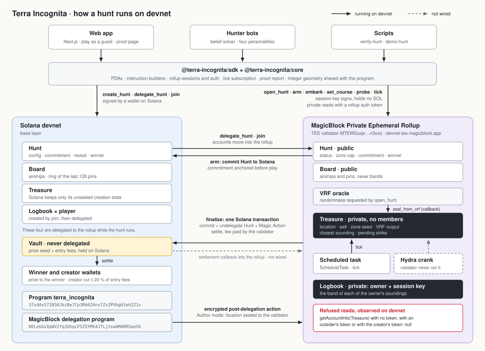

# Terra Incognita

Terra Incognita is a global treasure hunt on Solana. A verifiable random number, delivered inside MagicBlock's Private Ephemeral Rollup, places a treasure somewhere on Earth and writes it into an account that no one is allowed to read. Players fly airships over a globe and take soundings. The program measures each distance inside the enclave and tells only that player how close the sounding was. Everyone sees where their rivals sound; nobody sees what they learned. A sounding within 50 km wins. If nobody strikes before the deadline, the closest sounding wins. The pot is paid on Solana in the same transaction that brings the hunt back from the rollup. When the hunt is over, anyone can check every hint against a commitment that was put on Solana before play began.

**A treasure hunt where nobody knows where the treasure is. Not even us.**

- Live app: `<LIVE_URL>`
- Video: `<VIDEO_URL>`
- Review in five minutes: [JUDGES.md](JUDGES.md)
- Every claim as a devnet link: [PROOF.md](PROOF.md)
- What we claim and what we don't: [CLAIMS.md](CLAIMS.md)

Program `37s4Ax372B3AJkcBe7Cp3RA6Z4ns7Zx2PVbgU1eh2Z1v` on Solana devnet. While a hunt runs, its accounts are delegated to MagicBlock's TEE validator `MTEWGuqxUpYZGFJQcp8tLN7x5v9BSeoFHYWQQ3n3xzo` (`devnet-tee.magicblock.app`, magicblock-core 1.0.0).

## Why it needs MagicBlock and Solana

A treasure hunt on a public chain has a basic problem: whoever stores the answer can read it, and so can everyone else. Each piece below removes part of that problem.

- **Private Ephemeral Rollup.** The treasure and every player's logbook live in accounts that the TEE validator refuses to serve. On devnet, reading the treasure with no token, with an outsider's token and with the creator's token all returned `null`. A logbook is served only to its owner and the owner's session key.
- **VRF inside the enclave.** `open_hunt` asks MagicBlock's VRF oracle for randomness, and the oracle's callback writes it straight into the private treasure account. Nobody picks the spot, including the creator. In two timed runs, the hunt armed on its first attempt 2.2 s and 0.96 s after the request. Once a hunt is opened for the audit, the VRF output re-derives the location, salt, zone seed, every zone centre and the commitment. A forged callback is refused.
- **Encrypted post-delegation action.** In Author mode, the creator's location and salt travel inside the delegation, sealed to the TEE validator's key. Only the validator decrypts them, and it runs `seal_from_action` in the rollup. On devnet they appeared neither in the Solana transaction nor in the delegation record.
- **Fast, free moves.** Embarking, setting a course and taking a sounding are rollup transactions signed by a session key that holds no SOL. The rollup produces a block about every 10 ms: during the three-bot hunt the validator advanced 8,984 slots in 90 s of block time.
- **Magic Action payout.** `finalize` reveals the location, commits the hunt back to Solana, undelegates it and attaches a call to `settle`. On Solana, all of that happens in one transaction, which the validator pays for and in which the vault pays the winner.
- **Scheduled crank.** A task on the validator calls `tick` on a timer. Each tick shrinks the public search zone, makes a pending strike public, closes the hunt at the deadline or finalizes it. On devnet these ticks took two hunts to the end with no client involved: one closed with the closest sounding winning and paid out, the other went void and refunded its creator.
- **Solana as the record.** The commitment to the location is committed to Solana before play, and the payout happens on Solana. The audit runs on public Solana data alone.

## How a hunt works

1. **Sealed.** The creator calls `create_hunt` on Solana, which moves the prize into a vault, and then delegates the hunt, its board and its treasure to the TEE validator. `open_hunt` makes the treasure private with no members and requests VRF randomness. The callback stores it. `arm` derives the location, a salt and a zone seed from the randomness, publishes `sha256("terra-incognita:v1" ‖ hunt ‖ location ‖ salt)`, and commits the hunt to Solana. The SDK's `createHunt` returns only once that commitment is visible on Solana. In the three-bot hunt it landed before any player joined.
2. **Set a course.** A player calls `join` on Solana, which pays the entry fee and registers a session key. This is the only time the wallet signs. The player then calls `embark` at a starting point and `set_course` to fly. Flight time is the straight-line chord between the two points at the hunt's speed (800 km/s by default). A ship can't change course or take a sounding while it is in the air.
3. **Take a sounding.** `probe` measures the distance from the ship to the treasure inside the enclave. It writes a band into the player's private logbook and pins the position, without the band, on the public board. Soundings have a 3 s cooldown, which starts at embark, and each ship gets 64. On a schedule, `tick` publishes a shrinking circle that always contains the treasure, with radii of 90°, 60°, 40°, 25°, 15°, 9°, 5° and 3°.
4. **Strike, or closest wins.** A sounding within 50 km is a strike. It is recorded privately and made public by the next `tick` in a later slot. If the deadline passes first, the closest sounding wins (the earlier one on a tie). A hunt with no soundings is void and refunds the creator. `finalize` reveals the location and salt, and the Magic Action pays out on Solana. After that, anyone can open the logbooks and the treasure and re-check every hint.

| Band | Name | Distance from the sounding |
| --- | --- | --- |
| 0 | strike | up to 50 km |
| 1 | scorching | 50 to 150 km |
| 2 | hot | 150 to 400 km |
| 3 | warm | 400 to 1,000 km |
| 4 | mild | 1,000 to 2,500 km |
| 5 | cool | 2,500 to 5,000 km |
| 6 | cold | 5,000 to 10,000 km |
| 7 | frozen | beyond 10,000 km |

Every distance test happens in integer cosine space on unit vectors, scaled by 10⁹. The program never uses trigonometry. The TypeScript in `packages/core` implements the same functions with the same tables, and both are tested against one shared file of reference vectors.

Hunts come in two modes. In **VRF** mode (the default, and the one this README is about), nobody chooses the location. In **Author** mode, the creator places the treasure and writes a riddle, so the creator knows the answer. By default the SDK sends the author's location encrypted inside the delegation (`delegate_hunt_sealed`), so it never appears in clear on Solana. Both modes publish the same commitment and support the same audit.

## Trust model

- **Trusted:** MagicBlock's TEE validator, which runs the program faithfully and enforces who may read which account, and MagicBlock's VRF oracle, which supplies unbiased randomness.
- **Not trusted:** the hunt creator, the players, and us.
  - The creator of a VRF hunt cannot choose the location and cannot read it. On devnet, a read of the treasure with the creator's token returned `null`.
  - A player can read only their own logbook, and can fly only their own airship. A rejected attempt returns `NotPilot`.
  - We run no service that sees the location. Our keys get the same `null` as everyone else's.
- **The Private Ephemeral Rollup controls reads only.** It decides who may read an account inside the rollup. It does not hide anything that gets committed to Solana. So the treasure is never committed while the hunt is live (its Solana copy still holds its empty creation state), and the location is written into the public hunt account only at `finalize`.
- **The location is published only at the end**, together with the salt. Anyone can hash them and compare the result with the commitment that was on Solana before play.

## Architecture



Solid arrows run on devnet. Dashed arrows are not wired: the settlement callback into the rollup, which we dropped, and the Hydra crank, which the validator never ran on its own.

## Accounts and instructions

| Account | Seeds | Where it lives | Who can read it |
| --- | --- | --- | --- |
| `Hunt` | `"hunt", creator, id (u64 LE)` | Solana, then delegated from creation until `finalize` | everyone |
| `Board` | `"board", hunt` | delegated until released after the end | everyone: airships and the last 128 pins, never bands |
| `Treasure` | `"treasure", hunt` | delegated; private with no members from `open_hunt` (or `seal_from_action`) | nobody until `open_treasure` after the end |
| `Logbook` | `"logbook", hunt, player` | created and delegated by `join`; private from `embark` | its owner and session key; everyone after `open_logbook` |
| `Vault` | `"vault", hunt` | Solana only, never delegated | everyone |

| Instruction | Layer | Who can send it | What it does |
| --- | --- | --- | --- |
| `create_hunt` | Solana | creator | creates hunt, board, treasure and vault; moves the prize and the fee budget |
| `delegate_hunt` | Solana | creator | delegates hunt, board and treasure to the hunt's validator |
| `delegate_hunt_sealed` | Solana | creator, Author mode | the same, with an encrypted `seal_from_action` attached to the treasure's delegation |
| `join` | Solana | player | pays the entry fee, creates and delegates the logbook, registers a session key |
| `open_hunt` | rollup | creator | makes the treasure private with no members; in VRF mode, requests randomness |
| `seal_from_vrf` | rollup | VRF oracle only | callback: stores the randomness in the treasure, nothing else |
| `seal_from_action` | rollup | the validator, as the post-delegation action; signed by the creator | makes the treasure private and places it in one step |
| `seal_from_author` | rollup | creator, Author mode | direct alternative: places the treasure after `open_hunt` (SDK option `sealed: false`) |
| `arm` | rollup | anyone, once sealed | derives the secrets, publishes the commitment, commits the hunt to Solana |
| `schedule_tick_legacy` / `schedule_tick` | rollup | anyone, while live | registers `tick` with the validator's task scheduler / with Hydra |
| `embark` | rollup | owner or session key | makes the logbook private, puts the airship on the board, starts the cooldown |
| `set_course` | rollup | owner or session key | flies to a new point; not while in flight |
| `probe` | rollup | owner or session key | takes a sounding: private band, public pin |
| `tick` | rollup | anyone or the scheduler, no signer needed | promotes a strike from an earlier slot, closes at the deadline, shrinks the zone, finalizes an ended hunt |
| `finalize` | rollup | anyone, once ended | reveals location and salt; commit + undelegate + `settle` action |
| `settle` | Solana | the Magic Action, or anyone as a fallback | pays the vault to the winner (minus the creator's cut) or refunds a void hunt; only once |
| `open_treasure` / `open_logbook` | rollup | anyone, after the reveal | makes the account public for the audit |
| `release_logbook` / `release_board` | rollup | anyone, after the reveal | returns accounts to Solana |
| `close_logbook` / `close_board` / `close_treasure` | Solana | anyone, once the account is released after `finalize` | returns rent to the player or the creator; `close_board` also returns the hunt account's unused fee budget |

## Verify a hunt yourself

Anyone can audit a finished hunt from public data. Here is the three-bot VRF hunt from [PROOF.md](PROOF.md):

```sh
npm install && npm run build:packages
npx tsx scripts/verify-hunt.ts FZM2qBDXCcRTP5gCzT1LgehJtuggUQw4SqZDwzDP6frY
```

```text
Terra Incognita hunt FZM2qBDXCcRTP5gCzT1LgehJtuggUQw4SqZDwzDP6frY
  "Three bots", vrf mode, status struck, winner H5Y7qBgXMgUxYaPvxpNC3Tj4f8ZXdHMKHepGuPNFyiPE

Commitment  2b5706532afd4736237eed4185be5b78a738dad2c5545fea4b3a5896dcbf6c7b
  anchored on Solana before play: https://explorer.solana.com/tx/74QDZ6Me…?cluster=devnet
Revealed    -23.7645, -37.4839
  sha256("terra-incognita:v1" | hunt | location | salt) = commitment: ok

Logbooks: 3 read, 0 still private
  …
    # 8  -23.6179, -37.7842     band 0 strike         35 km  ok
Entries: 25 re-measured, 0 mismatches

Payout on Solana: 0.0154 SOL to the winner, 0.0006 SOL to the creator
Verdict: VERIFIED
```

The script reads the commitment that was committed to Solana before play, hashes the revealed location and salt, and compares the two. It then re-measures every sounding in every logbook against the revealed location and finds the payout transaction on Solana. If a finished hunt still has private logbooks, the script first opens them with the permissionless `open_logbook`, which is free on the rollup and signed by a throwaway key. `--no-open` skips that step.

To see a forged reveal fail, add `--tamper`. It moves the revealed location 300 km before checking. The commitment no longer matches, 5 of the 25 soundings land in the wrong band, and the script exits with code 1. Exit codes: `0` verified, `1` mismatch, `2` incomplete or not finished, `3` error.

## Repository layout

```text
programs/terra_incognita/   Anchor program (Rust)
  src/lib.rs                instructions and account constraints
  src/geo.rs                integer geometry; its tests load packages/core/vectors/geometry.json
  src/blind.rs              branch-free selections used where the secret is involved
  src/state.rs, errors.rs   account layouts, limits, error codes
packages/core/              the same geometry in TypeScript, commitment, VRF derivations, audit
packages/sdk/               client: decoders, instruction builders, rollup sessions, sealed actions, flows, proof report
packages/hunter/            solver, four bot personalities, in-memory simulator, on-chain bot runner, benchmark
apps/web/                   Next.js web app
scripts/                    verify-hunt.ts, demo-hunt.ts
tests/                      devnet integration suites (ts-mocha)
docs/architecture.svg       the diagram above
```

Each package has its own README. [`packages/hunter/README.md`](packages/hunter/README.md) explains how the solver works and includes the benchmark.

## Quick start

You need Node 22 or newer (we use 24). To build the program you also need Rust 1.89.0, Agave 3.1.9 and Anchor CLI 1.0.2.

```sh
npm install
npm run build:packages            # core, sdk, then hunter
npm run test:packages             # core 100, sdk 32, hunter 77 (+1 devnet test each in sdk and hunter, skipped by default)
npm run test:program              # 27 Rust unit tests, including the geometry parity check; no network
```

Audit a finished hunt (read-only for this hunt; no key needed):

```sh
npx tsx scripts/verify-hunt.ts FZM2qBDXCcRTP5gCzT1LgehJtuggUQw4SqZDwzDP6frY
```

Run a demo hunt with bots. You need a devnet key with SOL: it seeds a 0.02 SOL prize, funds each bot with 0.03 SOL and sweeps the rest back afterwards.

```sh
npx tsx scripts/demo-hunt.ts --treasury ~/.config/solana/id.json --bots surveyor,sprinter,shadow
```

The script creates a VRF hunt (or reuses a live demo hunt from the same key), plays the bots until the hunt is over, waits for the payout, prints the audit and recovers the rent. See [`scripts/README.md`](scripts/README.md) for all options.

Run the devnet integration suites. They create real hunts and spend devnet SOL from `ANCHOR_WALLET`, and they need the IDL and types from `anchor build`:

```sh
npm run build:program
npm run test:devnet
```

Last results: lifecycle 12/12, simulation-oracle 6/6, confidentiality 4/4 and author-sealed 3/3 on the final program; vrf-hunt 7/7, negative 7/7, crank 3/3 and sealing 3/3 on the previous upgrade, which differs only by the two sealed-path instructions.

Run the web app:

```sh
npm run build:packages
npm run dev -w @terra-incognita/web
```

## Environment variables

| Variable | Used by | Default | Purpose |
| --- | --- | --- | --- |
| `TERRA_BASE_RPC` | scripts | `https://rpc.magicblock.app/devnet` | Solana RPC |
| `TERRA_ROLLUP_RPC` | scripts | `https://devnet-tee.magicblock.app` | rollup RPC |
| `TERRA_ROUTER_RPC` | scripts | `https://devnet-router.magicblock.app/` | MagicBlock router, used to locate delegated accounts |
| `TERRA_VALIDATOR` | scripts | `MTEWGuqxUpYZGFJQcp8tLN7x5v9BSeoFHYWQQ3n3xzo` | validator that new hunts delegate to |
| `TERRA_TREASURY_KEY` | `demo-hunt` | `~/.config/solana/id.json` | path of the funded key that creates demo hunts |
| `ANCHOR_WALLET` | devnet suites | `~/.config/solana/id.json` | payer for the devnet suites |
| `BASE_RPC`, `TEE_RPC`, `ROUTER_RPC`, `TEE_VALIDATOR` | devnet suites | the devnet values above | endpoints for the suites |
| `TERRA_KEYS_DIR` | devnet suites, hunter e2e | `keys/` (suites), `~/.config/solana` (e2e) | where test wallets are kept |
| `TERRA_EVIDENCE_LOG` | devnet suites | unset | file the suites append signatures and observations to |
| `TERRA_DEVNET` | sdk and hunter devnet tests | unset | `1` enables the encrypted author hunt (sdk) and the three-bot hunt (hunter) |
| `TERRA_TREASURY` | hunter e2e | `deployer` | name of the funding key file in `TERRA_KEYS_DIR` |
| `<WEB_APP_ENV>` | web app | | |

## Security

### The rule: no error and no public write may depend on private state

On MagicBlock's private rollup, `simulateTransaction` withholds logs, compute units and account state for a transaction that touches a private account. It still returns the transaction's error, including custom program error codes, to any caller with a session token. On devnet, an outsider and the creator both got `{"InstructionError":[1,{"Custom":6003}]}` back from a simulated `arm`. Simulations cost nothing and leave no trace. So if an instruction can fail, or succeed differently, depending on where the treasure is, every simulation becomes a free question about the answer.

Our first deployment broke this rule. Simulating `[embark(X), probe, probe]` returned `NotLive` (6011) when X was within 50 km of the treasure and `Cooldown` (6018) everywhere else, even for a wallet that had never joined. Our own test caught it, and the next upgrade fixed it.

How the program meets the rule now:

- **`probe` checks only public state, then stops branching.** Live, started, deadline, embarked, probe limit, in flight and cooldown are all read from the public hunt and board before the secret is touched. After that point, the private treasure and logbook are updated only through branch-free selections (`blind.rs`). Nothing can fail and nothing public is written.
- **A strike stays private until a later slot.** `probe` records the first strike in the treasure (player, slot, timestamp). Only `tick` copies it to the public hunt, and only when the strike's slot is earlier than the current one. Inside one transaction or one slot, the public state looks the same whether or not there was a strike.
- **`embark` starts the cooldown,** so `[embark, probe]` fails the same way at any point on the globe.
- **Compute must not depend on the result either.** A caller can binary-search the compute limit. We measured a 2 CU difference: a probe needed 25435 CU at the treasure and 25433 CU at two far points. We traced it to the overflow checks in the `i64` dot product, which compiled to branches on the operands' signs. `dot` now uses wrapping arithmetic, which is safe because its inputs are unit vectors and cannot overflow, and flags pass through volatile loads so the optimiser can't turn them back into branches. On the final program a probe needs 25534 CU at the treasure and at both far points, and `[probe, tick]` needs 47075 CU in all three places.
- **`tests/simulation-oracle.test.ts` checks this on devnet.** It simulates `[embark, probe, probe]`, `[probe, probe]`, `[probe, tick]`, `[probe, tick, finalize]` and `[probe, finalize]` from a ship sitting on the treasure and from one on the far side of the globe, and expects identical errors. It also expects identical minimal compute budgets, `null` post-state even for the logbook's own member, and no change to the hunt afterwards.

The general lesson for anyone building on a private rollup: every instruction's error code, compute use and public writes are public outputs, even when its logs and accounts are not.

### Other safeguards

- `seal_from_vrf` accepts only the VRF oracle's identity. A forged callback is refused with `ConstraintAddress`.
- `delegate_hunt_sealed` accepts only actions whose single signer is the hunt's creator. `seal_from_action` checks the creator, the mode and the status, and runs only once per treasure.
- `arm` refuses an unsealed treasure (`NotSealed`), so no commitment can exist before the randomness does. `open_hunt` and `arm` in one transaction fail.
- Every position a player supplies is re-normalised on-chain. The slack allowed by the unit-vector check therefore can't buy a closer sounding.
- A session key can only embark, set a course and take soundings for its own logbook. Prizes always go to the owner's wallet.
- `settle` runs only after the hunt is back on Solana in a final state, and only once (a second attempt returns `AlreadySettled`). The creator's cut is capped at 20 % of entry fees, and the prize seed always goes to the winner, or back to the creator if the hunt is void.
- The hunt account pays the rollup fees and signs its own commits with its seeds. The escrow for the settlement action is funded at creation.

## Honest limits

- **Devnet only.** Nothing here has run on mainnet, and the program has not been audited.
- **The TEE validator is trusted.** If MagicBlock's validator or its enclave were compromised, or misapplied its access control, the location would leak. We tested what an outside caller can do through the RPC and its websocket (`getAccountInfo` with and without `dataSlice`, `getMultipleAccounts`, `getProgramAccounts`, `getBalance`, `getSignaturesForAddress`, `getTransaction`, `getSignatureStatuses`, `getBlock`, `simulateTransaction`, `accountSubscribe`, `programSubscribe`, `logsSubscribe`). We did not check enclave attestation or the validator's host.
- **What an observer still learns.** These are the limits our confidentiality suite records:
  - sounding time and position are public by design;
  - anyone holding a private transaction's signature learns its slot, block time and success;
  - private account addresses derive from public seeds but read like missing accounts;
  - a logbook is readable (empty) until its owner embarks;
  - `getProgramAccounts` filtered by logbook size returned 18 public logbooks (opened after hunts, or not yet embarked).
- **The VRF callback can't be seen while a hunt runs.** No read we tried located it: not by address, not by block, not through the request logs. Its arrival shows only indirectly, because `arm` succeeds only once the treasure is sealed. After the three-bot hunt was opened for the audit, the rollup did return that hunt's callback transaction ([PROOF.md](PROOF.md), section 2).
- **The rule above must hold for every future instruction.** The rollup returns errors from simulations, so a single careless `require!` on private data would reopen the oracle.
- **The program is upgradeable.** The upgrade authority is our deployer key `Ca7fJbX3CWYVu3sHuWuEiFxpRk9rUsdV7pFdPKNQJg9p`, and the devnet binary has not been checked against this source with a verified build.
- **Author mode has a different trust model.** The creator chose the location and knows it. The encrypted seal keeps the location off Solana, but it does not hide it from its author. With `sealed: false`, the location goes to the rollup endpoint in a direct `seal_from_author` transaction instead.
- **Some things are public by design.** Pins, airship positions, timing and the shrinking zone are public. A rival can learn from where you sound, but not from what you heard.
- **A strike is public only after the next `tick`.** Until then other players can keep sounding. In the three-bot hunt a rival took another sounding 7 slots after the winning strike. Only the first strike is recorded, so a later one can't take the win.
- **After the end, everything opens.** The location, salt and logbooks are published for the audit, and the rollup's transaction history for a hunt that has been opened then reads in full.
- **Cranks.** The validator's task scheduler (`ScheduleTask`, deprecated in the SDK we build on) is the path that works. We register with Hydra as well. Its crank accounts are valid, and a manual trigger ran our tick, but nothing triggers ephemeral Hydra cranks on the TEE validator at priority tip 0: one Hydra crank was 515,180 slots overdue with 0 executions. Scheduled ticks keep firing for a while after a hunt has left the rollup, and they fail harmlessly. With no crank at all, any client can call `tick`, and the SDK and the bots do so after a strike or a deadline.
- **Settlement fallback.** If the Magic Action never arrived, anyone could call `settle` directly once the hunt is back on Solana. In every hunt in our logs the action paid first, so the direct path has only been exercised as a refusal while the hunt was still delegated.
- **Latency.** About 10 ms is the rollup's block interval, not what a player feels. From our client, an `open_hunt` was confirmed after 962 ms in one timed run and after 2239 ms in another.
- **Limits.** 64 players per hunt, 64 soundings per ship, the last 128 pins on the board. The largest hunt we have played on devnet had three players.
- **Geometry.** Distances are measured on a sphere with radius 6371.0088 km, not on an ellipsoid. Distances shown in the app are floating-point and for display only. Every decision on-chain is made in integers.
- **The solver benchmark is a simulation.** Its numbers come from 1,000 simulated hunts per row, not from live play.

## Not in scope / next

- **Settlement callbacks** that return the payout receipt into the rollup: not shipped. We dropped them from this version.
- **Hydra crank:** the validator has not run our crank with a zero priority tip, and we haven't tried a non-zero tip. Until then the legacy scheduler does the work.
- **Mainnet, an audit and a verified build.**
- **Token prizes.** Prizes and entry fees are SOL only.
- **Bigger hunts.** More than 64 players needs a larger board, or more than one.

## License

MIT, see [LICENSE](LICENSE).
